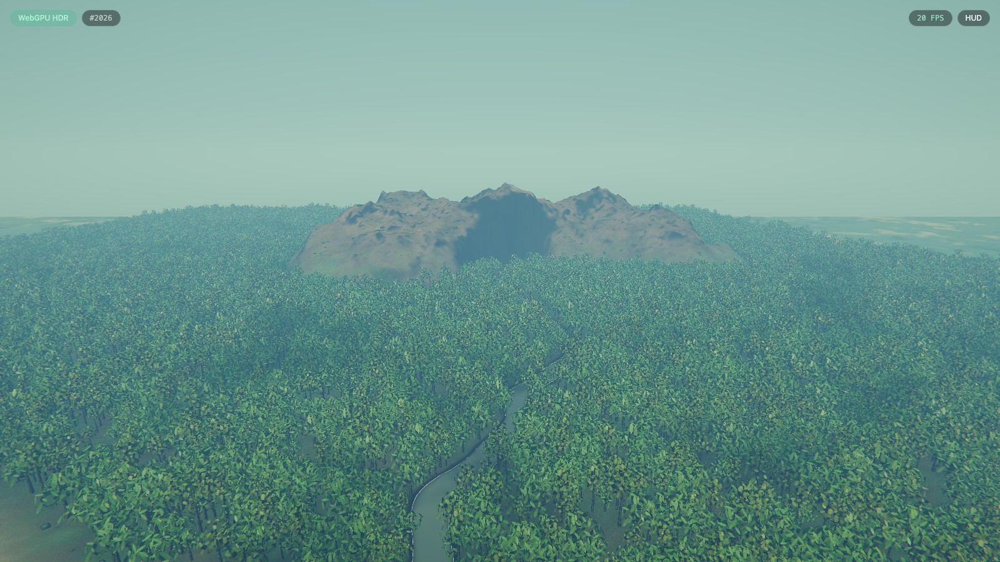
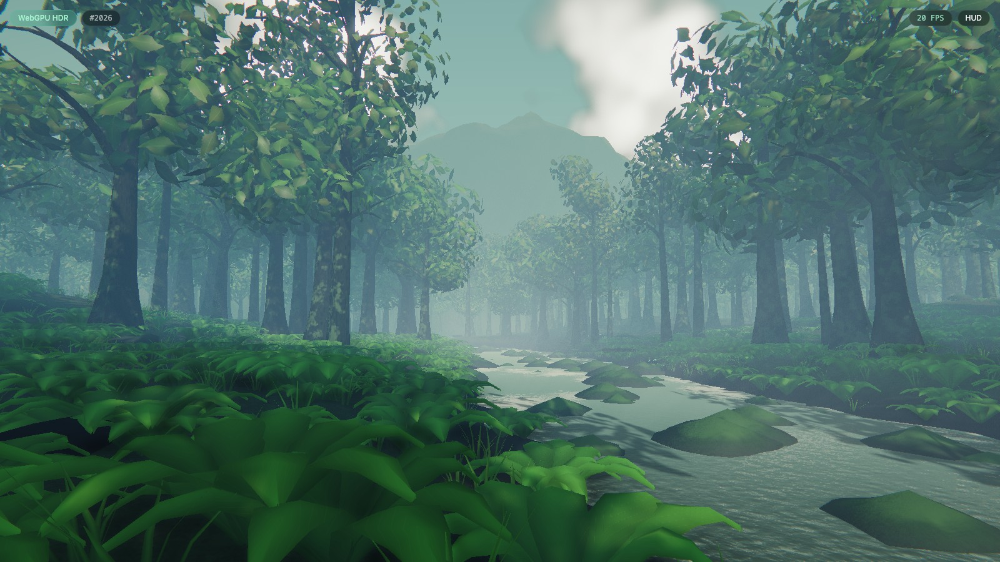
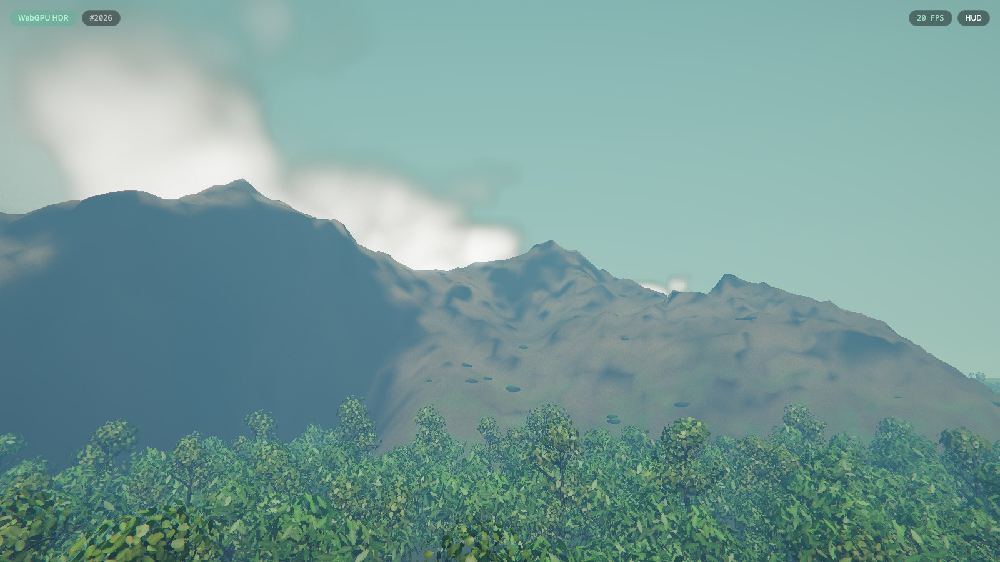
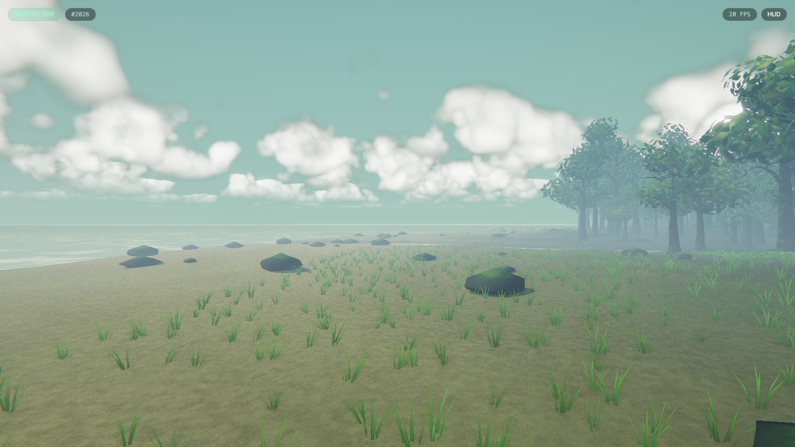
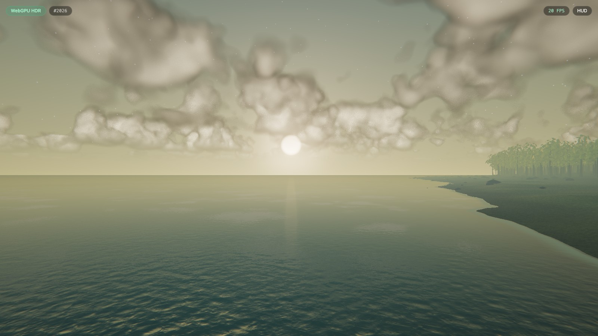
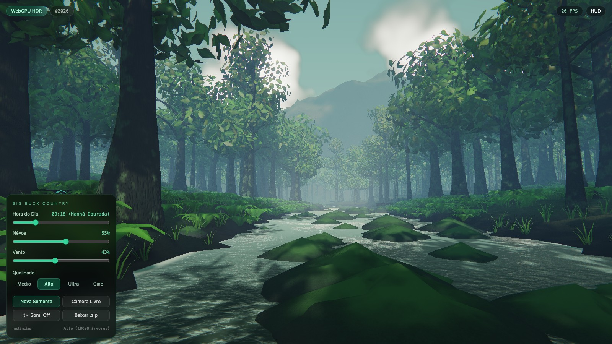

# Big Buck Country — Motor de Floresta Procedural em WebGPU

Motor de floresta procedural ultra-realista renderizado em **WebGPU**, escrito em **JavaScript puro (ES Modules)** — sem build step, sem `package.json`, sem dependências de npm. O único recurso externo é o Tailwind via CDN para o HUD.

## Imagens

| | |
|---|---|
|  |  |
| **A ilha** — maciço central, mata fechada, rios e mar em toda a volta | **Floresta** — duas espécies de árvores, copas multicamadas |

| | |
|---|---|
|  |  |
| **Maciço** — cristas erodidas (fbm com derivada, estilo iq), scree e prado alpino | **Restinga** — faixa de areia que contorna a ilha inteira |

| | |
|---|---|
|  |  |
| **Sotobosque** — samambaias, rochas e o rio corrente | **Entardecer** — ciclo de dia completo, do amanhecer às estrelas |

| | |
|---|---|
|  |  |
| **Noite** — cogumelos e vagalumes bioluminescentes | **HUD** — hora do dia, névoa, vento, qualidade e exportação |

## Características

- **Uma ilha inteira, ~2.2km × 1.65km**: a planta vive em `src/island.js` — contorno da costa por série de Fourier polar, maciço central alongado SO–NE (cadeia de cápsulas) e cinco rios com meandros que nascem no sopé e deságuam no mar
- **Do centro para fora**: maciço rochoso (cristas FBM amortecidas por derivada — `mountainIq`, portado do shader fdlyW4 do iq — scree, prado alpino e neve por altitude/declividade) → mata fechada com clareiras e capões → praia de areia (~78m) → mergulho sob o oceano
- **Tudo procedural e determinístico**: terreno, árvores (duas espécies, copas multicamadas), rochas, samambaias, grama, troncos, cogumelos e esporos — mesma seed, mesmo mundo (`PRNG` + FBM/ridge noise)
- **LOD de instâncias**: o renderer só desenha as células visíveis; copa em detalhe cheio até `treeDetailDist`, cartões planos até `treeLodDist`, sub-bosque com fade por `understoryDist`
- **Instâncias com apoio físico**: rochas amostram a malha renderizada e assentam sobre o ponto mais baixo da sua projeção; troncos repousam sobre o contato mais alto — nada flutua
- **Pipeline PBR**: Cook-Torrance GGX, shadow mapping com PCF 3×3, céu atmosférico com nuvens procedurais, sombras de nuvens, estrelas, God Rays sobre o shadow map, SSAO e Bloom HDR
- **Áudio procedural**: sintetizador Web Audio (vento, rio, ambiente) — sem arquivos de som
- **Exportador `.zip`**: baixa o projeto modular inteiro pelo botão no HUD

## Como Executar

Não há build. Sirva a pasta estaticamente com `npx` — **na porta 3000**:

```bash
cd big-buck-country
npx serve . -l 3000
# ou: python3 -m http.server 3000
```

Abra `http://localhost:3000`. Requer navegador com WebGPU: Chrome/Edge recentes ou Safari 18+. Sem WebGPU, o overlay de intro avisa (`Sem WebGPU`) — não há fallback WebGL.

## Controles

| Entrada | Ação |
|---|---|
| `WASD` / setas | Mover |
| Mouse (clique para pointer-lock) ou arrastar | Olhar |
| `Shift` | Correr |
| `Espaço` / `C` | Subir / descer (voo) |
| HUD | Hora do dia, névoa, vento, qualidade, nova semente, passeio automático, som, exportar `.zip` |

## Presets de Qualidade

| Preset | Shadow map | Passos God Ray | Res. terreno | Instâncias (alvo) |
|---|---|---|---|---|
| Médio | 1024 | 12 | 380² | ~0,7 M |
| Alto | 2048 | 20 | 540² | ~1,2 M |
| Ultra | 3072 | 28 | 680² | ~1,6 M |
| Cinematográfico | 4096 | 36 | 820² | ~2,0 M |

As contagens são o total da ilha inteira (árvores + copas + sub-bosque). O custo por frame vem das distâncias de LOD de cada preset, não do total gerado.

## Estrutura

| Arquivo | Responsabilidade |
|---|---|
| `index.html` | HUD (Tailwind CDN), canvas e entry point ES Module; carrega os fontes para o exportador ZIP |
| `src/main.js` | `WebGPURenderer` (device, pipelines, shadow pass, HDR/bloom) + `BigBuckApp` (câmera, input, UI, loop) |
| `src/world.js` | `ForestWorld` — heightmap da ilha, construtores de mesh e `generateInstances` |
| `src/island.js` | Planta da ilha — costa, maciço central e rede de rios, compartilhada entre o relevo e o shader de água |
| `src/shaders.js` | `WGSL_SHADERS` e `WGSL_POST_SHADERS` — pipeline principal e pós-processamento em WGSL |
| `src/math.js` | `PRNG` determinístico, `ProceduralNoise` (value noise, FBM, ridge) e `Mat4` |
| `src/quality.js` | `QUALITY_PRESETS` — dpr, shadowRes, godRaySteps, terrainRes, contagens e distâncias de LOD |
| `src/audio.js` | `ForestAudio` — sintetizador procedural Web Audio |
| `textures/` | Texturas fotográficas do pacote de mídia do Shadertoy — **CC BY-NC-SA 3.0**, © shadertoy.com |
| `screenshots/` | Capturas do mundo atual usadas neste README |
| `godot/` | Port em progresso para **Godot 4 + C#** (mesma seed, mesma ilha) — ver `godot/README.md` |

## Licença dos Assets

As texturas em `textures/` vêm do pacote de mídia do Shadertoy e estão sob **CC BY-NC-SA 3.0** (© shadertoy.com) — uso não comercial com atribuição e compartilhamento pela mesma licença. Todo o código e a geração procedural são do projeto.
