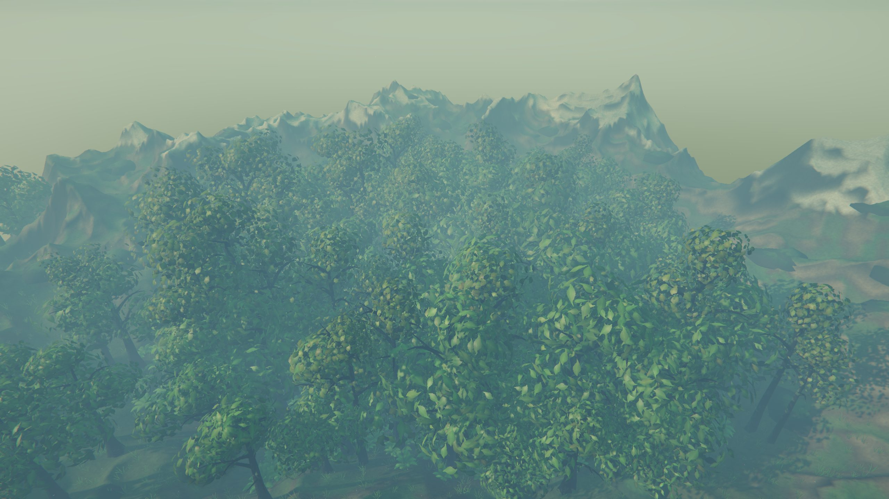
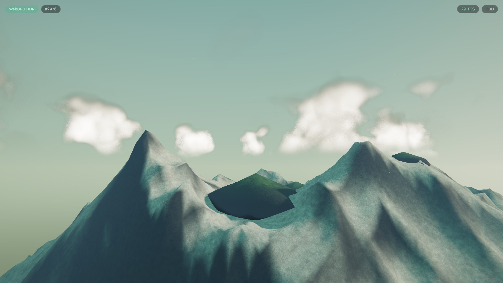
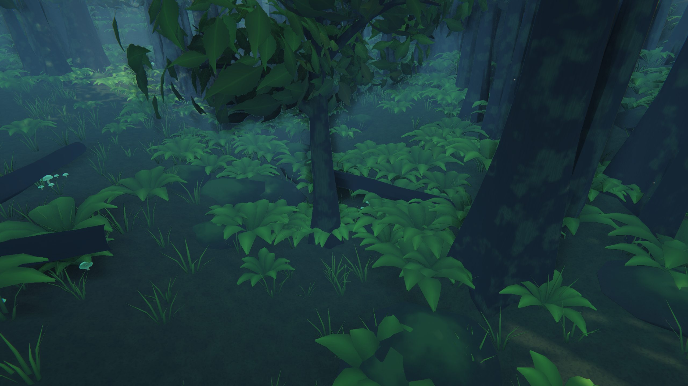
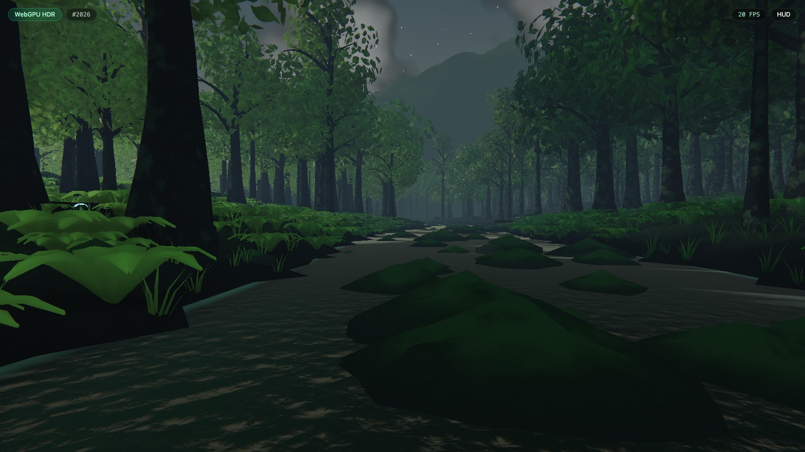

# Big Buck Country — Motor de Floresta Procedural em WebGPU

Motor de floresta procedural ultra-realista renderizado em **WebGPU**, escrito em **JavaScript puro (ES Modules)** — sem build step, sem `package.json`, sem dependências de npm. O único recurso externo é o Tailwind via CDN para o HUD.

Arquitetura modular inspirada em *Abyssal Garden*.

## Imagens

| | |
|---|---|
|  |  |
| **Vale florestal** — duas espécies de árvores, copas multicamadas | **Mapa unificado** — vale rodeado pelo maciço nevado |

| | |
|---|---|
|  |  |
| **Maciço** — cristas erodidas (fbm derivada, estilo iq), scree e neve | **Sotobosque** — samambaias, troncos caídos e rio |

| | |
|---|---|
|  |  |
| **Entardecer** — ciclo de dia completo | **Noite** — cogumelos e vagalumes bioluminescentes |


## Características

- **Mapa unificado**: vale florestal com rio sinuoso de água corrente no centro, rodeado por maciço montanhoso (inspirado no "Canyon" do iq) com transição contínua e linha das árvores por altitude
- **Dois biomas em um mundo**: floresta (copas multicamadas, bioluminescência) e montanha (estratos rochosos, picos nevados, prado alpino)
- **Tudo procedural e determinístico**: terreno, árvores, rochas, samambaias, grama, troncos, cogumelos e esporos — mesma seed, mesmo mundo (`PRNG` + FBM/ridge noise)
- **Instâncias com apoio físico**: rochas amostram a malha renderizada e assentam sobre o ponto mais baixo da sua projeção; troncos repousam sobre o contato mais alto — nada flutua
- **Pipeline PBR**: Cook-Torrance GGX, shadow mapping com PCF 3×3, céu atmosférico com nuvens procedurais, sombras de nuvens, estrelas, God Rays e Bloom HDR
- **Áudio procedural**: sintetizador Web Audio (vento, rio, ambiente) — sem arquivos de som
- **Exportador `.zip`**: baixa o projeto modular inteiro pelo botão no HUD

## Como Executar

Não há build. Sirva a pasta estaticamente com `npx` — **na porta 3000**:

```bash
cd big-buck-country
npx serve . -l 3000
# ou: python3 -m http.server 3000
```

Abra `http://localhost:3000`. Requer navegador com WebGPU: Chrome/Edge recentes ou Safari 18+. Sem WebGPU, o overlay de intro avisa (`Sem WebGPU`) — não há fallback WebGL.

## Controles

| Entrada | Ação |
|---|---|
| `WASD` / setas | Mover |
| Mouse (clique para pointer-lock) ou arrastar | Olhar |
| `Shift` | Correr |
| `Espaço` / `C` | Subir / descer (voo) |
| HUD | Hora do dia, névoa, vento, qualidade, nova semente, passeio automático, som, exportar `.zip` |

## Presets de Qualidade

| Preset | Shadow map | Passos God Ray | Res. terreno | Instâncias |
|---|---|---|---|---|
| Médio | 1024 | 12 | 150² | ~11k |
| Alto | 2048 | 20 | 210² | ~22k |
| Ultra | 3072 | 28 | 260² | ~35k |
| Cinematográfico | 4096 | 36 | 310² | ~50k |

## Estrutura

| Arquivo | Responsabilidade |
|---|---|
| `index.html` | HUD (Tailwind CDN), canvas e entry point ES Module; carrega os fontes para o exportador ZIP |
| `src/main.js` | `WebGPURenderer` (device, pipelines, shadow pass, HDR/bloom) + `BigBuckApp` (câmera, input, UI, loop) |
| `src/world.js` | `ForestWorld` — heightmap por bioma, construtores de mesh e `generateInstances` |
| `src/shaders.js` | `WGSL_SHADERS` e `WGSL_POST_SHADERS` — pipeline principal e pós-processamento em WGSL |
| `src/math.js` | `PRNG` determinístico, `ProceduralNoise` (value noise, FBM, ridge) e `Mat4` |
| `src/quality.js` | `QUALITY_PRESETS` — dpr, shadowRes, godRaySteps, terrainRes e contagens de instâncias |
| `src/audio.js` | `ForestAudio` — sintetizador procedural Web Audio |
| `textures/` | Texturas fotográficas do pacote de mídia do Shadertoy — **CC BY-NC-SA 3.0**, © shadertoy.com |

## Licença dos Assets

As texturas em `textures/` vêm do pacote de mídia do Shadertoy e estão sob **CC BY-NC-SA 3.0** (© shadertoy.com) — uso não comercial com atribuição e compartilhamento pela mesma licença. Todo o código e a geração procedural são do projeto.
